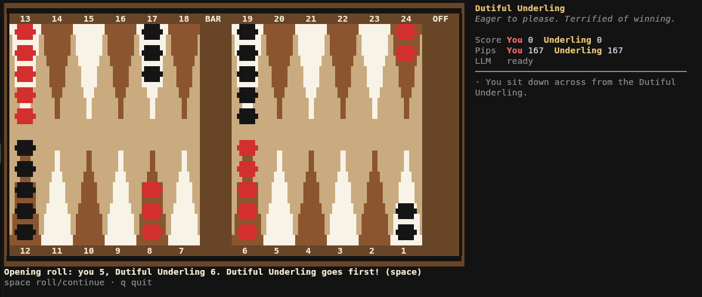

# Backgammon

A terminal backgammon game (Go + [Bubble Tea](https://github.com/charmbracelet/bubbletea))
played against a local LLM served by [llama.cpp](https://github.com/ggml-org/llama.cpp),
in one of six personas, or any opponent you make up.



```sh
go build -o backgammon . && ./backgammon
./backgammon --llm-url http://localhost:8888 --model ornith-1.0-35b-Q4_K_M
```

`BACKGAMMON_LLM_URL` and `BACKGAMMON_MODEL` work too. With no model given, the first
model the server lists is used.

## How the AI plays

The rules engine (`internal/game`) generates every legal play and ranks them with a
heuristic. The LLM receives the board from its own point of view plus the top 10
candidates, and returns `{"choice": n, "comment": "..."}`. The output is constrained
with a JSON schema and reasoning is disabled, so a move takes about 2 seconds. If the
server is unreachable or the reply is unusable, the heuristic's top play is used along
with a canned in-character line, so the game never stalls.

The AI also reacts to your moves. When you finish a turn, the engine ranks your play
against every alternative and grades it (forced, best, solid, questionable, blunder),
noting hits, new points, blots and checkers borne off. The persona gets that grade in the
same request as its own move and replies with a `reaction` before choosing, so reactions
add no latency. The grading heuristic is opinionated and sometimes wrong, much like a
human opponent.

Colors default to 24-bit (`--color truecolor`), because many terminals that support it
still report `TERM=xterm`, which would otherwise drop the palette to 16 colors. Use
`--color auto`, `256` or `16` if your terminal shows garbled colors.

## Your own opponents

Choose **+ New opponent…** (or press `n`) on the opponent screen and describe who you
want to play. A name like "Grumpy Cat" is enough, and you can add as much detail as you
like. The LLM writes the full character: a display name, a tagline, the voice used as
its instructions, and canned lines for when the LLM is unavailable. New opponents are
saved to `~/.config/backgammon/personas.json`, which is created if it's missing. Edit
that file to tweak a character. Use `--personas <file>` or `BACKGAMMON_PERSONAS` to
choose a different file. The six built-in personas live in the code and are never
written to the file.

```json
{
  "version": 1,
  "personas": [
    {
      "name": "Grumpy Cat",
      "tagline": "Judges your dice rolls with silent contempt.",
      "voice": "You are a perpetually unimpressed feline ...",
      "fallback": ["Meh.", "I expected better.", "Do not touch my fur."],
      "win": ["I was always going to win. It is disappointing how obvious it was."],
      "lose": ["The dice were defective. Clearly."],
      "prompt": "Grumpy Cat"
    }
  ]
}
```

## Controls

| Key | Action |
| --- | --- |
| space | roll / continue |
| ←/→ (or h/l, tab) | cycle through movable checkers or destinations |
| enter | select checker / make move / finish turn |
| esc | cancel selection |
| u | undo a move this turn |
| n | new opponent (on the opponent screen) |
| n / p | new game / change opponent (after a game) |
| q | quit |

No doubling cube yet. Gammons (2 pts) and backgammons (3 pts) count toward the session score.
